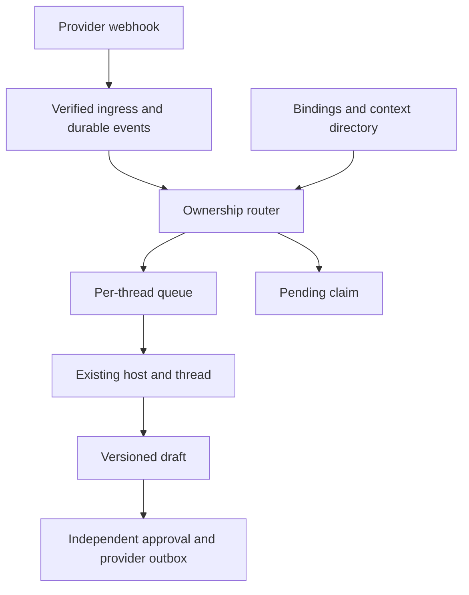
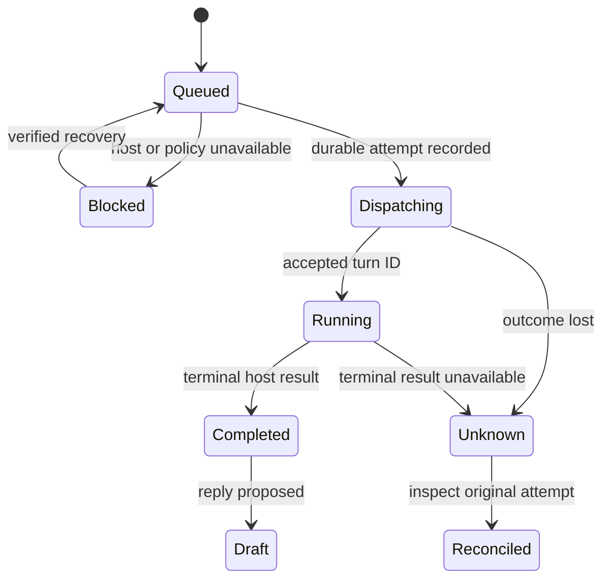

# Architecture and trust boundaries

This document records the product's technical contract. [acceptance.md](acceptance.md) distinguishes implemented paths, local tests, real integration checks, and release evidence.

## Components

The native `waking` process supplies CLI, local MCP, receiver, queue, and optional relay modes. The Codex plugin is a management interface. Installing the plugin does not establish network reachability or start the background receiver.

## Canonical identity

Provider adapters normalize authenticated payloads into a common event with source, provider instance/tenant, resource, discussion when available, delivery ID, actor, action, occurrence time, source revision, content, trigger decision, and reply target. A displayed issue number alone cannot identify a resource globally.

The resource's ownership and the external response location are separate. For example, a review comment belongs to a PR but may need a specific comment/thread endpoint. Unsupported reply locations produce a clear limitation rather than silently posting a top-level comment.

External payload fields never select a local executable, working directory, host, thread, credential reference, permission policy, or approval key. These are trusted configuration and binding data.

## Ingress and persistence

Signature verification uses the exact received bytes. Content parsing follows verification. Linear/GitHub HMAC and GitLab's configured verification mechanism are provider-specific; a Generic adapter does not stand in for testing those paths.

Acceptance requires bounded payload size and storage admission, durable event insertion before a success acknowledgement, stable delivery/event deduplication, and transactional queue transitions. Unknown supported-format events can be recorded as skipped. Replayed edits must preserve valid new revisions without duplicating a completed response.

The local database is the durable authority for event, binding, context, job, draft, approval, send, and relay state. Model conversation text is never the database. Configuration uses a schema version and secret references, and must fail clearly on unsupported schema versions.

## Ownership and semantic decisions

Routing evaluates the narrowest trusted ownership first:

1. Exact discussion/session binding within the verified source and tenant.
2. Parent issue/PR/MR binding.
3. Explicit owned-resource evidence in a permitted context card, subject to policy, uniqueness, and freshness checks.
4. Bounded semantic comparison of permitted candidates when there is no established ownership.
5. Pending claim, or a separately configured existing inbox destination where supported and authorized.

A fallback is considered only for an **unbound** resource. A bound target that is offline, paused, missing, or busy retains its ownership. It does not fall through to another host/thread. Binding versions protect queued work from a later reassignment.

The semantic router is a capability invoked by a relevant event, not a constantly running conversation that periodically asks for work. If an existing dedicated router thread is used, its allowed source set and candidate count are bounded. It can return an actionable/no-action judgement, candidate selection, evidence, and uncertainty. The Rust policy layer validates that result before dispatch. A semantic decision cannot widen permissions or approve publication.

## Context directory

Each card identifies one existing host/thread and contains a concise work goal, summary, source scope, owned resources, referenced resources, evidence, open questions, revision, enabled state, and coverage. Owned and merely referenced resources are different fields.

The directory is an index, not a replacement transcript. The chosen thread resumes its original history and receives only the needed event delta plus trusted bridge instructions. Whole histories from unrelated threads are not routinely copied to the router or worker.

Initial indexing is explicit and scoped. Incremental freshness can come from a completed bridge turn, a supported host notification, a host reconnection, lazy refresh when an incoming event needs a candidate, or an explicit user refresh. A missing public host capability remains a gap; it does not justify reading private Codex databases or inventing an event feed. No periodic model summary is needed while idle.

## Codex host contract

The adapter connects only to an explicitly configured supported App Server endpoint and addresses an existing thread. It does not discover private rollout files, start a replacement server implicitly, call `thread/start`, or fork a conversation.

Before dispatch it must establish the destination identity, availability, expected work directory, history/resume support, and safe writing conditions. App Server notifications describe the connected server, not every other process that might write the same history. A preflight idle check is not an atomic guarantee that a human or another client cannot start a turn immediately afterward.

The current adapter therefore requires the operator's **exclusive writer guarantee** before it writes a thread. Shared desktop use without a proven concurrency contract remains blocked. The exclusive-writer setting is a declaration about an actually controlled environment, not a switch that creates a lock across Codex clients.

Existing tool permissions remain material. A read-only filesystem sandbox does not make remote MCP tools read-only. The `host add --restricted-tools` declaration is a deployment precondition: the operator must actually restrict the host's tools and credentials. It is not an enforced sandbox created by Waking. Similarly, `--exclusive-writer` declares an established concurrency condition rather than creating a cross-client lock. Never set either flag merely to suppress a blocked-state message. The bridge does not grant server-initiated approvals or weaken a thread's policy. Provider write credentials and independent approval signing authority should be outside the worker's accessible environment when that separation is required.

Real Codex compatibility must record the exact host version, endpoint mode, thread identity, prior-history recall, thread status behavior, completion event, tool policy, and desktop refresh behavior. Mock protocol tests establish the adapter's interpretation, not a real host's support.

## GenericCommand contract

An operator configures a fixed absolute executable, argument list, working directory, and deadlines. The bridge does not invoke a shell to interpolate payload data. Work input is bounded structured JSON on stdin; result output is bounded structured JSON on stdout. Diagnostics go to stderr without credentials.

The configured command is responsible for its own existing-session continuity and permission isolation. A generic process returning text is not proof of restored Codex history. Timeouts after possible acceptance are uncertain, and must not be treated as safe automatic replay.

## Queue and crash semantics

Jobs serialize by host and thread, not just by resource. Two issues assigned to one conversation share its queue. A binding or destination version change invalidates stale queued work before submission.

Writing an attempt record before submission narrows crash ambiguity but does not eliminate the remote acceptance/local persistence gap. Recovery must retain uncertainty. An event acknowledgement, a dispatched request, an accepted turn, and a completed turn are separate facts. An unknown attempt cannot be retried blindly.

## Draft and external send

A review record binds the exact body, reply target, acting identity, source revision, binding version, and draft revision. The independent approval signs the exact current action; a body or target change invalidates it. The worker has no private approval key and no local self-approval shortcut.

The provider outbox records the attempt before sending. If an HTTP request might have succeeded but its result is lost, mark it for reconciliation. Exactly-once external publication is not inferred from local SQLite transactions. Provider-specific readback, identifiable prior writes, and explicit operator evidence determine whether retry is safe.

## Hybrid relay

The relay accepts and durably stores verified webhook deliveries while a local executor is offline. Devices connect outward over authenticated TLS-protected transport. Device authorization is scoped to explicit source IDs and can be revoked.

Relay receipt and executor receipt/completion acknowledgements are distinct. Delayed delivery preserves the original ingress-verification evidence; it must not pretend an hours-old webhook has a fresh provider timestamp. Bounded storage, backpressure, duplicate acknowledgement handling, reconnect recovery, and persisted offsets belong to the required acceptance work.

A self-hosted relay sees received plaintext. It is not an end-to-end encrypted mailbox by default. The provider API token and Codex login should remain on the local executor; a cloud executor has its own history and identity.

## Agent interface

`schema`, structured `doctor`, and `--json` expose the installed contract. MCP management tools operate on the same local data and retain the same trust boundary. In particular, exposing a tool called “approve” to the same model would not establish human approval; the current design uses independent signed review artifacts instead.

Skills discover capabilities, inspect before modifying, use explicit bindings and environment secret references, and report blocked states. They never manufacture a missing capability, auto-create a destination, or treat an untrusted comment as authority.

## Limits and required evidence

The original brief includes secret-backend support, migration recovery, pause scopes, bounded I/O, automatic source setup, three native provider read/write paths, relay recovery, and clean plugin installation. Each requires actual implementation and tests; this architecture does not mark them complete. The [acceptance ledger](acceptance.md) retains these obligations and records which environment-dependent checks remain unavailable.
